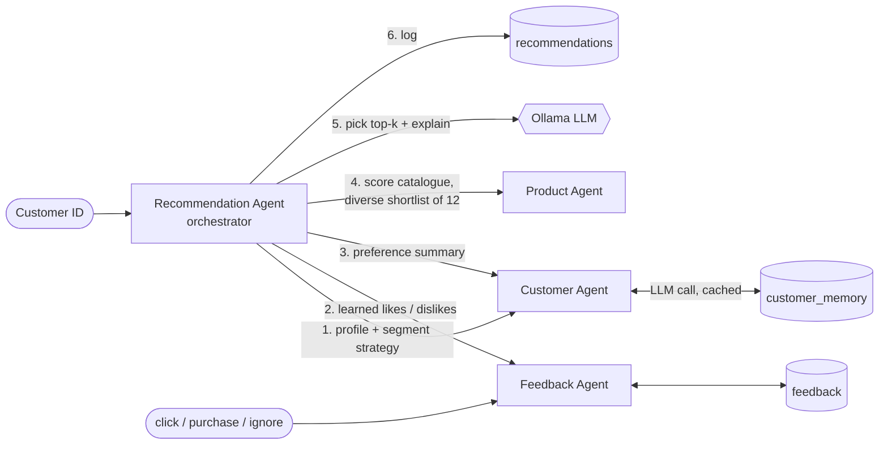

# Smart Shopping Suggestions

A local, multi-agent recommender that delivers hyper-personalized product recommendations for an e-commerce store. It uses an on-prem Ollama LLM and SQLite as long-term memory.

Built for Accenture's **"Hack the Future: A Gen AI Sprint"**, Problem Statement 2: *Smart Shopping: Data and AI for Personalized E-Commerce*.

## 📝 Problem statement

Retailers collect browsing, purchase and demographic data, then segment customers and choose products for each segment by hand. The challenge asks for a multi-agent AI system in which customer, product and recommendation agents work together. Together they analyze browsing behavior, predict preferences and improve the shopping experience. The goals are higher engagement, average order value, retention and conversion.

How this project covers the required technology:

| Requirement | Implementation |
|---|---|
| Multi-agent framework | Customer, Product, Feedback and Recommendation agents (`Smart_shopping/agents/`) |
| SQLite DB for long-term memory | `db/ecommerce.db`: catalogue, plus `feedback`, `customer_memory`, `recommendations` and `product_embeddings` tables |
| Ollama on-prem LLM | Preference summaries, plus re-ranking and explaining the shortlist (`llama3` by default) |
| Ollama embedding model | Optional semantic matching with `nomic-embed-text` (`build_embeddings.py`) |
| Segment-specific recommendations | Frequent Buyers get related items; New Visitors get popular, top-rated items; Occasional Shoppers get seasonal picks |

## 🧠 Agent interaction design



1. **Customer Agent** loads the profile and chooses a strategy, i.e. a set of scoring weights, from the customer segment.
2. **Feedback Agent** turns earlier clicks, purchases and ignores into liked and disliked product types, plus products to hide.
3. **Customer Agent** asks the LLM for a one-sentence preference summary. The summary is cached in `customer_memory` and regenerated only when the customer's history or feedback changes.
4. **Product Agent** scores all 10,000 products on interest, related-to-purchases, popularity, quality, seasonal/holiday/geo fit, price fit, and optionally embedding similarity. It returns a diverse shortlist of 12 (at most 2 per product type and 4 per category).
5. **Recommendation Agent** gives only the shortlist to the LLM, which picks the top-k and writes a customer-facing reason for each. Product IDs the LLM invents are rejected. The LLM's order is then treated as a preference, and the code still ensures the picks span the customer's interest categories, because llama3 sometimes picks three items from one category.
6. Every recommendation is logged. Feedback on it changes the next run (see the demo below).

**Without Ollama**, every step still works: preferences and reasons come from rules, and ranking uses the scores. The CLI and web UI show which mode is active.

## 🔧 Installation

Prerequisites: Python 3.10+ and [Ollama](https://ollama.com) (optional, but needed for LLM features).

```bash
git clone https://github.com/aaatishphadte/genai-hackathon
cd genai-hackathon/Smart_shopping
pip install -r requirements.txt

ollama pull llama3             # LLM (change with OLLAMA_MODEL)
ollama pull nomic-embed-text   # optional, for semantic matching
python build_embeddings.py     # optional: ~10 min, adds ~40 MB to the DB (don't commit it)
```

`db/ecommerce.db` is already built. To rebuild it from the CSVs, run `python build_sqlite_db.py`.

## 🚀 Usage

```bash
python app.py                          # web demo at http://127.0.0.1:5000
python main.py                         # interactive CLI
python main.py --customer C1001        # one customer
python main.py --no-llm --top 5        # rule-based only
python evaluate.py --sample 0          # offline evaluation on all customers
pytest tests                           # 20 tests, using a fake LLM
```

Settings are environment variables: `OLLAMA_MODEL`, `OLLAMA_EMBED_MODEL`, `OLLAMA_URL`, `OLLAMA_TIMEOUT`, and `SMART_SHOP_DB`.

Feedback in action (CLI, customer C1001):

```
  1. P4977  Books / Biography    (Brand C, ₹768, ★4.6)   score 0.84
  2. P7393  Fashion / Jeans      (Brand D, ₹663, ★4.9)   score 0.81
  3. P6156  Fitness / Treadmill  (Brand B, ₹1003, ★4.1)  score 0.79
> 1 purchase, 2 ignore, 3 click

🔁 Updated recommendations using your feedback:
  1. P4279  Books / Biography    score 0.89  ↳ Similar to the Biography items you liked and a good pick for Autumn.
  2. P6156  Fitness / Treadmill  score 0.89  ↳ Similar to the Treadmill items you liked and a good pick for Autumn.
  3. P7846  Fashion / Shoes      score 0.81  ↳ A good pick for Autumn and goes well with your earlier purchases.
```

The purchased product and the ignored jeans drop out, the clicked treadmill moves up, and Fashion is still covered by a different product type.

There's also a JSON API: `GET /api/recommend/C1001?top=5`.

A 92-second recorded walkthrough of the web demo, with llama3 running locally, is in [demo/smart_shopping_demo.mp4](demo/smart_shopping_demo.mp4).

## 📊 Evaluation

`evaluate.py` hides each customer's last purchase, recommends 3 products from the remaining history, and checks whether the hidden item was recovered. Results on all 10,000 customers, with no LLM:

| Method | Product type hit@3 | Category hit@3 |
|---|---|---|
| **Multi-agent** | **44.5%** | **100%** |
| Popularity baseline | 12.3% | 32.7% |
| Random | 12.2% | 42.3% |

Caveat: in this synthetic dataset, each browsed category has exactly one purchase. The hidden item is therefore always in the one category the customer browsed but hasn't bought from, and the agents boost exactly that signal (browse-abandonment retargeting). That makes the 100% category hit partly a result of how the data was built. Within a category, product type appears random in the data, so about 46% is the best reachable product-type score.

## 📁 Structure

```
Smart_shopping/
  agents/            customer, product, feedback, recommendation agents
  utils/             SQLite schema/connection, Ollama client
  templates/         web UI
  db/ecommerce.db    SQLite: catalogue + long-term memory
  main.py            CLI          app.py   Flask web demo
  evaluate.py        offline evaluation
  build_sqlite_db.py CSV -> SQLite   build_embeddings.py  products -> Ollama embeddings
  tests/             pytest suite
```
